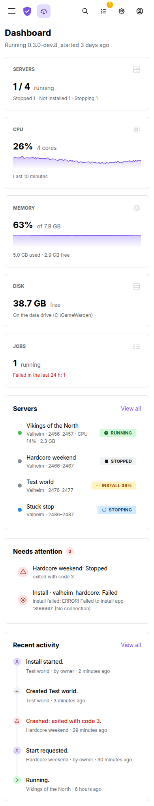
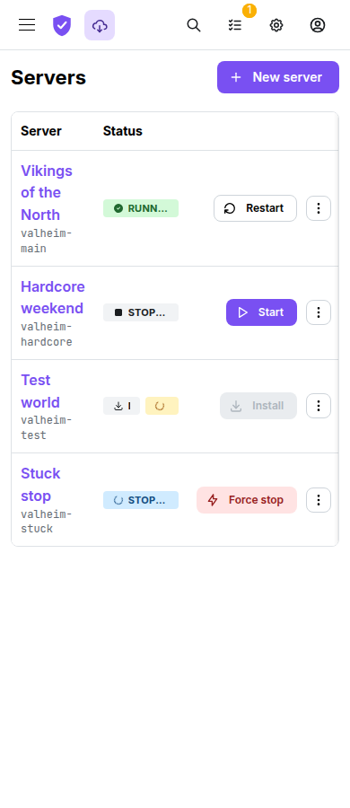
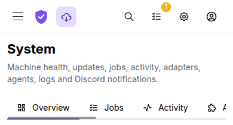
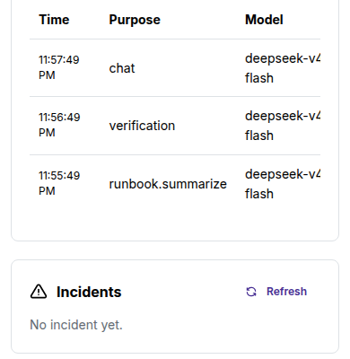
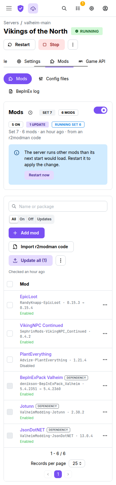
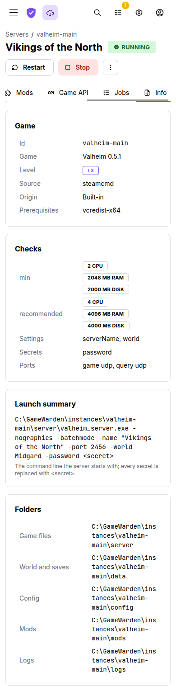
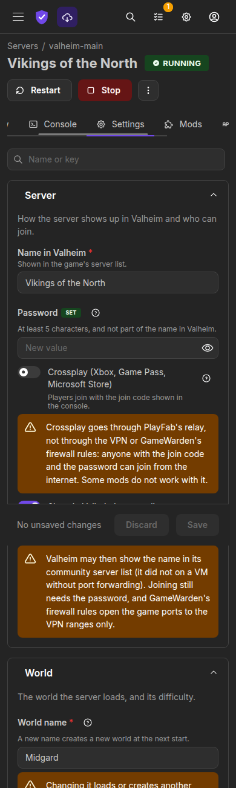
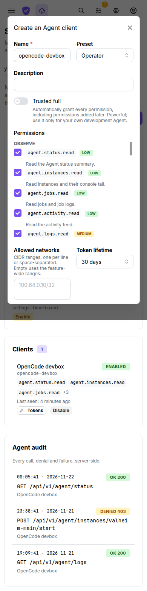
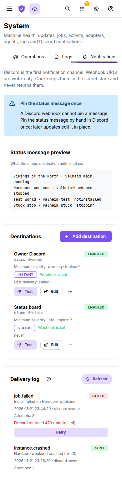
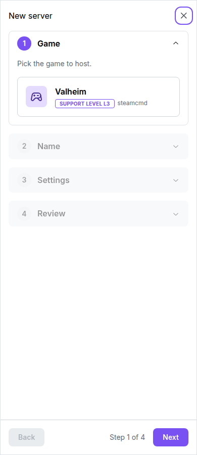

# 22 · Panel UX review and redesign proposals

**Status: proposed by the agent on 2026-11-22; Batch 1 (mobile and truth), Batch 2 (daily screens), Batch 3
(first run and setup) and Batch 4 (task-first navigation) are built (PR #96–#102, #104).** The Owner decided the
direction of Batch 4 on 2026-11-23 ([ADR-0035](../decisions/0035-task-first-navigation-activity-and-phone-bottom-bar.md)).
[07](07-ux-and-user-flows.md) and [11](11-web-panel.md) stay the contract.

Baseline: `origin/main` at `485614b` (the merge of PR #94), reviewed against [07](07-ux-and-user-flows.md),
[11](11-web-panel.md), [12](12-explanations.md) and the pinned [`ux-playbook`](../.claude/skills/ux-playbook/SKILL.md)
([ADR-0029](../decisions/0029-panel-ux-from-the-ux-playbook-skill.md)).

## Not built yet

- [x] **Batch 1 — mobile and truth (built 2026-11-22, PR #100):** section picker on phones, missing
  loading/empty/error states, one date formatter, the hard-coded strings in `en.ts`/`vi.ts`, unsaved-changes guards,
  platform-aware token copy (§11.1). The card rows for the squeezed tables landed with Batch 2 (#96–#97).
- [x] **Batch 2 — daily screens (built 2026-11-22, PR #96–#98, #101):** the dashboard, server and system screens in
  §11.2, including the Settings warning reduction (PR #101).
- [x] **Batch 3 — first run and setup (built 2026-11-23, PR #102):** zero-server onboarding, wizard game cards with
  radio semantics, the Agent permission picker without nested scrolling, console follow/command hints, and the
  Notifications destination Drawer on phones (§11.3).
- [x] **Batch 4 — task-first navigation (built 2026-11-23, PR #104):** Activity becomes a top-level destination and
  phones get a four-item bottom bar; Jobs stays a System tab with its header shortcut. The Owner chose this B-lite
  option after the measurement; full Option B (Activity and Jobs) was not built
  ([ADR-0035](../decisions/0035-task-first-navigation-activity-and-phone-bottom-bar.md)).

## 1. Method

- Read the product docs and the playbook, then walked the signed-in panel on `npm run dev:mock`.
- Captured **19 routes × 1280 / 390 px × light / dark** (76 screenshots), plus 18 flow states: sign-in, first-run
  setup, mobile navigation, command palette, update dialog, delete dialog, new-server wizard (valid and invalid),
  settings with unsaved changes, Add mod, Import code, Share code, config drawer, help drawer, notification form,
  Agent create/tokens/mode.
- Inventoried the code behind those screens: every data view's loading/empty/error state, tables below 768 px,
  `disabled` actions and whether their reason is reachable, icon-only controls, hard-coded strings, date formats and
  unsaved-changes handling.
- Compared the same problems in other panels: Pterodactyl and Pelican, AMP, the Tide theme for Pterodactyl 2.0 and
  Calagopus (§10).
- Evidence used in this page is in [`docs/panel/ux-review`](panel/ux-review).

What this review did **not** do: a real-device pass (the screenshots are a headless Chrome at 390 px), a screen-reader
pass, or a measurement on the VM over Radmin. Those stay in the manual checks of [10 §8](10-build-test-release.md#8-manual-tests-on-the-vm).

## 2. What is already good and should stay

The panel is not a pile of ad-hoc screens; most of the hard parts are right:

- **One visual language.** Mantine, violet primary, one `StatusBadge` mapping, one `PageHeader`, one empty/error look,
  light and dark both designed. The calm "operations console" character of [11 §5](11-web-panel.md#5-visual-style) is
  visible on every screen.
- **Safety.** Delete asks for the id; force stop, rollback, restore and destination removal confirm; the update dialog
  lists what stops, what keeps running and what can be lost, and offers to copy the backup paths.
- **Explanations.** The shared help drawer ([12](12-explanations.md)) is better than most products of this size: each
  choice has one place that explains it, with sources at the end.
- **Mods.** The set model, the batch bar, dependencies that explain why they cannot be changed, config revisions and
  the r2modman share/import flow are coherent and unusual in a good way.
- **Console and logs.** Monospace, search, copy, download, pause/follow, virtualised rows, filters in the URL and a
  phone list for logs. The pieces exist; a few are not carried across to every log view.
- **Internationalisation.** `en.ts` and `vi.ts` are typed to the same keys and the tests enforce it; most screens use
  it correctly. The exceptions are listed in §3.2 M9.

### 2.1 What the review changed

Batch 1 (mobile and truth) was built on 2026-11-22 in PR #100:

- **Phones:** `SectionPicker` replaces the scrolling tab strip on System and on a server; the current section and
  the tab icons stay, and desktop keeps the tabs.
- **States:** the wizard game picker and Review, the server Overview recent jobs, the phone Jobs list, the console,
  the dashboard numbers, the Operations sub-cards and the Navbar server list now have loading, empty and error
  states from §3.1.
- **Time:** `RelativeTime` and `formatWhen` give every user-facing date one policy — relative under 24 hours, locale
  date and time after that, ISO in the tooltip; log tables keep a fixed timestamp inside the same component.
- **Words and copy:** the remaining Operations strings are in `en.ts`/`vi.ts`; the Agent token copy names the
  machine that runs the Agent client.
- **Unsaved edits:** Settings, Operations and the config editor (including the Drawer's close button) ask before
  leaving; switching config tabs keeps the draft.

Batch 2 (daily screens) was built on 2026-11-22 in three PRs:

- **PR #96** — the dashboard "Now" line and phone order; server cards with the full state word and CPU/RAM, plus a
  Resources column on the desktop table; the Info definition list, monospace paths with copy, and the remaining
  hard-coded labels; `GameWarden 0.3.0-dev.8 · up 3 days`.
- **PR #97** — Mods and Config files as cards on phones, a labelled "Mods on" switch, one `ModStateBadge`, the Game
  API player action menu with words, and the Settings "Jump to section" picker.
- **PR #98** — Operations split into Setup and Agent activity, model-call and trace cards on phones, a visible
  "Avg latency" label, the approvals hint, and the Notifications cleanup (dismissible pin hint, collapsible preview,
  last-delivery time, full-screen form on phones).

Still open from Batch 2: none; the Settings warning reduction landed in PR #101.

Batch 3 (first run and setup) was built on 2026-11-23 in PR #102:

- **Getting started**: a dismissible card replaces the zero-server dashboard (account, prerequisites, first server,
  Discord notifications, data folder); the normal empty dashboard returns when it is dismissed.
- **Wizard**: the game picker is a `Radio.Group` of `Radio.Card`s with arrow keys, `aria-checked`, a selected style
  and a group error when Next is pressed without a game.
- **Agent dialog**: preset cards with counts (Observer / Operator / Debugger / Full / Custom), a selected count and
  no nested scroll area; the dialog is full-screen on phones.
- **Console**: Ctrl/⌘ F focuses the search, the command hint sits under the field and a disabled command says why.
- **Notifications**: the destination form is a Drawer on phones with a sticky footer; desktop keeps the Modal.

The first-run card's third row opens the data folder, not a backup schedule: the backup defaults of
[07 §4](07-ux-and-user-flows.md#4-first-run-setup-wizard-loopback-only) step 5 are not built yet.

## 3. Findings

Severity follows the playbook's rubric: **B** = blocker (meaning or data lost, main task blocked),
**M** = major (needs a fix or a written reason), **m** = minor.

This table records the baseline review. Batch 1–3 (§11) say which rows the code now fixes; the rows still open are
the details those batches did not cover and Batch 4.

| ID | Severity | Finding | Evidence |
|---|---|---|---|
| B1 | blocker | The tab strip hides whole sections on phones; on System four sections and part of a fifth are out of view and nothing signals it | `tabs-phone.png` |
| B2 | blocker | Four mobile tables lose primary information: a state word is truncated, a file name is clipped, a model-call table is cut, a path wraps mid-segment | `servers-phone.png`, `mods-phone.png`, `operations-tables-phone.png`, `info-phone.png` |
| B3 | blocker | Unsaved edits are lost on navigation; no form warns before leaving | flow walk, code inventory |
| B4 | blocker | Several data views have no loading, empty or error state; one query error leaves the wizard on a skeleton forever | §3.1 |
| B5 | blocker | The Agent token copy names a Unix file mode and path without saying which machine it belongs to | `agents-create-phone.png` |
| M1 | major | On a phone the dashboard shows five statistics before any server state, and a fresh install has no onboarding | `dashboard-phone.png` |
| M2 | major | Version, uptime and update are said three different ways; one sentence reads like a log line | `dashboard-phone.png`, System Overview |
| M3 | major | Several disabled actions have no visible reason, only a tooltip or nothing | §3.2 |
| M4 | major | Game API player actions are three icon-only controls; the user has to guess shield/crown/ban | Game API screenshots |
| M5 | major | Operations is 4,300 px on a phone, mixes setup with diagnostics, has an unlabeled chart and a pending-approval count with no action | `operations-tables-phone.png`, `agents-create-phone.png` |
| M6 | major | Settings is a 2,000+ px form with no section navigation; warning blocks dominate the page | `settings-dark-phone.png` |
| M7 | major | The wizard's game picker has no selected state, no loading/empty/error and no radio semantics | `wizard-phone.png` |
| M8 | major | Four date/time formats coexist and ignore the panel language | §3.2 |
| M9 | major | User-facing strings are hard-coded in English on Info, Operations, traces and placeholders | §3.2 |
| M10 | major | Notifications leads with a permanent instruction and a preview; last delivery has no time | `notifications-phone.png` |
| M11 | major | "Friends join at this address" shows `localhost` when the panel is opened on the VM | Server Overview |
| m1 | minor | "CPU (of the whole machine)" is ambiguous on a server page | Server Overview |
| m2 | minor | BepInEx log has refresh only, while the server console has search/copy/download | Mods log screenshot |
| m3 | minor | The spotlight shows "Jobs / Jobs", "Activity / Activity" duplicated descriptions | Spotlight flow |
| m4 | minor | Setup says "Create the Owner account" then the button says "Create the account" | Setup flow |
| m5 | minor | The System page description lists all eight areas above a tab description that repeats one | System screenshots |
| m6 | minor | "Id" (Info, notifications) instead of "ID"; "Last update: Now running…" | Info, System Overview |
| m7 | minor | Per-server Jobs has no empty state on phones (desktop has one) | Code inventory |

### 3.1 Detail: the missing states (B4)

| View | Missing |
|---|---|
| Wizard → game picker | loading, empty, error; the list is `adapters.data?.adapters ?? []` |
| Wizard → Review | error: a failed system query keeps the skeleton forever |
| Server Overview → Recent jobs | loading and error |
| Jobs (phone list) | empty |
| Console | loading: the empty text is shown while the first lines arrive |
| Dashboard → overview numbers | empty wording: a fresh install renders `0 / 0` |
| Operations → Observability, Traces | error (a failed query renders as "no data") |
| Operations → Incidents | empty and failure use the same text |
| Operations → Quality | error only as a toast that disappears |
| Navbar server list | while loading or on error it is silently empty |

### 3.2 Detail: the cross-cutting majors

**M2, version and update wording.** The dashboard says "Running 0.3.0-dev.8, started 3 days ago"; System says the same
and then "Last update: Now running 0.3.0-dev.8. (November 18, 2026 7:49 PM)". The same fact appears as a header pill,
a "Latest" line and a violet update banner. Proposal: one sentence ("GameWarden 0.3.0-dev.8 · up 3 days · update
available") and one update card that owns version → latest → action → last result.

**M3, disabled without a reason.** Checked by keyboard and by touch:

- Mods: the `Mods on` switch is disabled while a job runs with no reason; bulk Enable/Disable/Update/Remove are
  disabled while busy with no reason; Add/Import/Update all have tooltip-only reasons.
- Operations: Save token / Save key are disabled on an empty input with no text; that is acceptable only if the empty
  field itself explains it, which it does not.
- Agents: the two feature switches are disabled while saving with no reason; Create is disabled with no reason.
- Logs: Clear filters is disabled when nothing is set, with no reason (the state is inferable, but not stated).
- Config editor: Edit and Save have tooltip-only reasons; Restore has no reason when the file is not editable.
- Game API: announce and unban are disabled on an empty input without a reason.

**M8, dates.** Relative (`fromNow`), locale `LLL`, numeric `L`/`LT`, fixed `YYYY-MM-DD HH:mm` and browser-locale
`toLocaleTimeString` all appear. `ClientTokensModal` shows `12/10/2026` — 10 December or 12 October? — while the rest
of the screen uses relative time. Proposal: one `RelativeTime` component (relative under 24 h, locale date/time beyond,
absolute value in `title`) and one server-time note on screens that show scheduled times.

**M9, hard-coded strings.** `servers/$id/info.tsx` ("Id", "min", "recommended", "CPU", "MB RAM"), Operations quality
("Answer", "Checks", "ok", "fail"), Observability ("tokens", "trace:"), Incidents/Traces ("system"), and several
placeholders. [11 §10 rule 1](11-web-panel.md#10-working-rules) and `panel/CONTRIBUTING.md` require every string in
`en.ts` and `vi.ts`; these are the exceptions.

**M11, the connect address.** `connectAddress()` builds `window.location.hostname:port`. Opened on the VM at
`localhost`, the card tells the Owner "Friends join at this address over the VPN" and prints `localhost:2456`. Safe fix:
when the host is loopback, say so and show the VPN/LAN addresses from Core; a Core endpoint that lists the machine's
reachable IPv4 addresses would let the panel show "This machine · Radmin · Tailscale · LAN" with one copy per address.
This is the same data the network step already needs.

## 4. Options (research note)

| | Option | What changes | Cost and risk | When |
|---|---|---|---|---|
| **A** | **Harden the current shell** (recommended now) | Same navigation and screens. Mobile section picker, responsive card rows, state coverage, wording/date/i18n, unsaved guards, zero-server onboarding, Operations split. | 4–6 small PRs; no API change except the optional address list; low risk | Now |
| **B** | **Task-first shell** | Promote **Activity** and **Jobs** to the sidebar; System becomes the settings hub (Overview, Adapters, Agents, Operations, Logs, Notifications); dashboard leads with a "Now" line; server list shows resources. | Navigation change, redirects for old paths, [07 §5](07-ux-and-user-flows.md#5-navigation) and [11 §3](11-web-panel.md#3-layout) update; medium | After A, measured |
| **C** | **Two-pane command center** | Persistent server rail and a workspace beside it; the dashboard becomes optional. | Large; breaks the simple page model; not justified for one Owner who already knows the servers | No |

**Recommendation: build A.** It fixes the meaning-losing bugs without a navigation bet. Then test B against three real
tasks on a phone — "the server is dead at 1 a.m.", "find why last night's job failed", "add a mod" — and only
move the sidebar if the tab strip is still the slow part. Option C is listed to close the question, not to build.

On 2026-11-23 the Owner chose a **B-lite** variant after the measurement: Activity moves to the top level with a
four-item phone bottom bar; Jobs stays in System with its one-action header shortcut
([ADR-0035](../decisions/0035-task-first-navigation-activity-and-phone-bottom-bar.md)).

## 5. Target experience

1. **Answer the daily question first.** "Is everything okay, and if not, what do I do?" belongs above statistics.
2. **The phone is a task list, the desktop is a dashboard.** Do not scale the desktop layout down; reorder and fold.
3. **One primary action per view.** A second filled button is a hierarchy bug.
4. **Status words are never truncated.** A badge may lose its icon, never its word; colour is never the only signal.
5. **Explain, do not just disable.** The reason sits in text the user can reach by keyboard and touch.
6. **One time format and one vocabulary.** "Up 3 days", "ID", "Deleted", not four variants.
7. **Every state has a face.** Loading has the shape of the content, empty has one action, error says what happened and
   offers retry.

## 6. Information architecture

Keep the shell and the four destinations (Dashboard, Servers, System, account). Changes that do not need an ADR:

- **Phones: replace the scrolling tab strip with a section picker.** A `Select` (or a `Menu` button) labelled
  "Section", showing the current tab, placed under the page header on System and on a server. Desktop keeps the tabs.
  This is one component used twice and removes B1 without a navigation change.
- **Phones: four visible destinations.** Dashboard, Servers, Activity and System sit in a bottom bar; the mobile
  drawer and its hamburger are gone. Desktop keeps the same four in the sidebar, with the server list under Servers
  ([ADR-0035](../decisions/0035-task-first-navigation-activity-and-phone-bottom-bar.md)).
- **Order System tabs by use, not history:** Overview · Jobs · Logs · Notifications · Agents · Operations ·
  Adapters, with a subtle separator before the setup group. The routes do not change; only `systemTabs` order.
  Activity is no longer a System tab.
- **Keep the server tab order.** Overview, Console, Settings, Mods, Game API, Jobs, Info matches the daily workflow.
- **Do not add a second sidebar.** If B is chosen later, promote Activity and Jobs and keep the same tab component.

## 7. Screen proposals

Each line is a tier M unless marked S.

### 7.1 Dashboard

- **Add a "Now" line under the title:** `All 4 servers are healthy · 1 job running · updated 20 s ago`; on a problem
  `Hardcore weekend crashed 29 minutes ago` with a link to the server. One line, colour + icon + words.
- **Phone order:** Now → Needs attention → Servers → statistics (2 columns, compact) → Recent activity. Desktop keeps
  statistics first.
- **Zero servers:** replace the five `0` cards with one onboarding card: *Create your first server* (opens the wizard),
  *Connect notifications*, *Check the data folder*. This is the "Getting started" card of [07 §4](07-ux-and-user-flows.md#4-first-run-setup-wizard-loopback-only), never built; the unused i18n key was removed in PR #94.
- **Update:** one mention in the header, one in the System card. The dashboard shows a link, not a second banner.

```
┌ Dashboard ────────────────────────────────────────────────────────────────┐
│ ● All 4 servers are healthy · 1 job running · updated 20 s ago            │
└───────────────────────────────────────────────────────────────────────────┘
```

### 7.2 Servers

- Phone: a card row per server with the full `StatusBadge`, game, ports and the primary action; overflow for the rest.
  The current table squeezes the name and truncates the state (`servers-phone.png`).

```
┌──────────────────────────────────────────────┐
│ ● Vikings of the North           ● RUNNING   │
│ Valheim · 2456–2457/udp · CPU 18% · RAM 2.3  │
│ up 5 h 12 m                                  │
│ [Restart]                              [⋯]   │
└──────────────────────────────────────────────┘
```
- Desktop: add `CPU` / `RAM` / uptime columns for running servers (the data already exists in `queries.metrics()`), and
  keep the primary power action at the end of the row. This is the Pelican grid/table and Tide list pattern.
- Add a search box when there are more than a handful of servers; keep it hidden otherwise.
- Keep "New server" as the only filled button.

### 7.3 Server shell and Overview

- Header: keep state + desired + actions. On phones, move the desired badge into the status tooltip (it is hidden
  today) and keep Restart/Stop visible.
- Resources: `SimpleGrid cols={{ base: 1, sm: 2 }}` so the two sparklines stack on phones; label the CPU as "share of
  the machine" and add the instance's own share when Core reports it.
- Status card: drop the duplicate `Status` row (the header already shows the badge); keep desired, game, process,
  restarts.
- Connect: list every reachable address (This machine, Radmin, Tailscale, LAN) with a copy button; never print
  `localhost` under "Friends join here". If Core cannot list addresses yet, show a warning when the host is loopback.
- Recent jobs: add loading and error; keep the four-row preview and "View all".

### 7.4 Console

- Keep the current layout; add the missing loading skeleton (three dim lines), a "Jump to latest" pill when the follow
  is paused, and a `Ctrl/⌘ F` hint in the search placeholder.
- Put the command input's disabled reason in text under the field, not only in the placeholder.

### 7.5 Settings

- Add a **section navigator**: a sticky list of the four sections on ≥md (a 180 px column or a `Select` above the form
  on phones), with the current section marked. The page is 2,000 px tall; the search box is not enough.
- Reduce warning noise: keep a one-line hint under a field; move the two-paragraph warnings into the existing help
  drawer, with the first sentence inline. The dark scheme currently turns four of them into large amber blocks.
- Guard unsaved changes (`useBlocker` + `beforeunload`), with the existing "1 unsaved change" footer as the source of
  truth; "Discard" keeps its confirmation.
- Keep Save disabled when nothing changed (the footer says why); this is the one place the product's pattern is
  clearer than the playbook default.

### 7.6 Jobs

- Global: add a state filter (All / Running / Failed) and group "Running" above history; the server filter stays.
- Phone: fix the empty state (the desktop table has one, the phone list renders nothing) and align the server filter
  full width like the other phone filters.
- Row: the log icon becomes a labelled "Log" action in the overflow on phones.

### 7.7 Info

- Replace the fixed two-column label/value grids with a definition list that stacks on phones. Today a Windows path
  wraps mid-segment (`info-phone.png`).
- Monospace for paths and the launch command; a copy button per value; the launch command gets its own block with
  wrap, not a paragraph.
- Move "Id" and the unit strings into i18n.

### 7.8 Mods, Config files, BepInEx log

- **Status strip:** turn the badge soup into one sentence, with the set id and the counts as text:
  `Set 7 · 6 mods · 5 on · 1 update · running set 6`. Put the switch in a labelled row ("Mods on") so it is not an
  unlabeled control.
- Phone: a card list per mod (name, package, version, newer, on/off, state, overflow), not the folded table. The
  current cell uses ` · ` separators and a green "Enabled" word, which loses the badge language.
- Config files: middle-ellipsis for long names with the full path in `title`, and a card row on phones; the file name
  currently clips at the card edge.
- BepInEx log: reuse the console viewer (search, copy, download, follow) or delete the view and link to the set's log
  in the console.

### 7.9 Game API

- Replace the three icon-only player actions with one overflow menu with words (`Make admin`, `Remove admin`, `Kick`,
  `Ban`) plus a reason prompt; keep the shield icon on the row to show current admin state.
- Announce and unban keep their empty-input state but say "Type a message first" next to the button.
- Version badge and world value use the same read-only style as the rest of the panel.

### 7.10 System Overview

- One update card: version → latest → update → last result; remove the duplicate lines and the "Now running" phrasing.
- Network: keep the CIDR chips but make it obvious they are read-only until *Change*; show the detected VPN names
  beside the ranges when Core knows them.
- Storage: paths monospace with copy; the RAM meter keeps its label.
- Prerequisites: unchanged; the installed / not-needed badges are clear.

### 7.11 Activity

- Phone: replace the five-segment filter with a "Filters" button that opens the existing drawer pattern (as Logs
  does), and make the server `Select` full width.
- Keep the timeline; add "Load older" if the feed is capped, and an absolute timestamp in `title`.
- Keep the actor (`by owner`, `by cli`) — it answers "who asked for it".

### 7.12 Adapters

- Keep the table; move the `1 adapter` count next to the title, not between the description and Reload.
- Add an empty state that says where an adapter folder goes (the text already exists in `en.ts`).

### 7.13 Agents

- Fix the token copy: say which machine the bridge runs on and give the path for its OS; "0600" alone is a Unix
  assumption (`agents-create-phone.png`).
- Permission picker: a preset summary (Read-only / Operator / Custom) with three groups and a count; no nested scroll
  area inside a scrolling modal on phones. The current modal has two scroll containers and hides the "Operate" group.
- Switches: show "On/Off" text and a reason when disabled while saving.
- Audit: absolute date when the entry is not from today; a row opens a detail drawer with the full action and error.
- Token expiry: one date format (M8), and a "Expires in 30 days" relative line.

### 7.14 Operations

- **Split it:** *Setup* (Discord, model, approvals) and *Activity* (observability, incidents, traces, quality) as two
  routes or two tabs under Operations. Setup is occasional; activity is diagnostic. This cuts the 4,300 px phone page
  in half and gives each view one job.
- Keep one Save in the setup view; the current top and bottom Save are both fine, but one is enough with a sticky
  footer on phones.
- Label the latency sparkline ("Model latency, last 24 h") or remove it; an unlabeled line is noise.
- Pending approvals: explain that Approve/Deny happens in Discord and link to the channel; a count with no action is a
  dead end.
- The "restart Core after changing the token/guild/channels" note moves under the fields it applies to, or into help.
- Mobile: model calls and traces become card rows; the tables are cut today.

### 7.15 Logs

- Keep it; it is the strongest screen for phones. Add a "Copy" action in the row drawer and one saved view ("Errors,
  last hour") as a chip beside the filters.

### 7.16 Notifications

- Move the "Pin the status message once" instruction into a dismissible info line or the help drawer; it occupies the
  first phone screen on every visit.
- Make the status preview collapsible ("Preview") and show the text only on demand.
- Destinations: show the last delivery as "failed 3 min ago" (relative + absolute in `title`), not just "Failed".
- The destination form becomes a Drawer on phones (a tall Modal with a footer below the fold is awkward); keep the
  same fields and the write-only webhook rule.
- "Id" → "ID"; the channel select keeps the plain words "Discord webhook" / "Discord bot".

### 7.17 Sign-in and setup

- Keep the centred card. Make the setup heading one line inside the card's 420 px width (`Create the Owner account`
  wraps today) and use the same verb on the button ("Create the Owner account").
- Keep the three-step `Stepper`; on phones it already wraps, but the step labels can shorten to "Account ·
  Prerequisites · Access".

## 8. Flow proposals

### 8.1 First run with zero servers

Dashboard → one onboarding card with three actions (create server, connect notifications, check the data folder) →
wizard. Today: five zero statistics, "All good", empty activity, and a small "No servers yet" card below the fold.
The facts come from [07 §4](07-ux-and-user-flows.md#4-first-run-setup-wizard-loopback-only); only the card is missing.

### 8.2 "The server is dead" at 1 a.m. on a phone (docs/07 §7)

Open the panel → the "Now" line says which server crashed and when → its card opens the server → Restart. Today the
Owner scrolls past five statistic cards before seeing a server state. Target: one screen, two taps.

### 8.3 Create a server

Servers → New server → game (radio cards with a clear selected state and the support level) → name → settings →
review (checks with ✓/⚠/✕) → Create & install. The current wizard is structurally right; the game card is a button
without `aria-pressed` and looks the same before and after selection, and a failed system query leaves the review on a
skeleton. Add loading/empty/error and a visible "Selected" state.

### 8.4 Change a setting safely

Settings → edit → the footer counts changes → Save → "Restart required" → Restart now / Later. Add the leave guard and
the section navigator; the rest matches [07 §7](07-ux-and-user-flows.md#7-key-flows).

### 8.5 Add mods as one batch

Mods → Add / Import → preview → Apply → one job builds one set → Restart to apply. Keep it. The mobile table and the
unlabeled switch are the gaps, not the flow.

### 8.6 Connect notifications

System → Notifications → Add destination → webhook (write-only) → mode/language/severity/topics/servers → Save →
Test. Keep the flow; shorten the pin note and give the status preview a disclosure.

### 8.7 Set up an Agent

System → Agents → Create agent → preset and permissions → create → copy the token once → run the bridge → approve
writes in Discord. The panel should say that last step explicitly, because "Pending approvals 1" is otherwise a dead
number.

### 8.8 Leave a form with changes

Any long form (Settings, config editor, Operations): a route blocker raises a small confirm dialog; `beforeunload`
covers a tab close. The wizard adds one line to its close button ("Discard this server?"). Today the edits are lost
without a word.

## 9. Cross-cutting patterns to build once

### 9.1 Responsive data views

- **≥ md:** table.
- **< md:** a card list, not a squeezed table. Each row keeps its status word, its name and one primary action; the
  rest goes to an overflow menu.
- If a table must stay scrollable, scroll only secondary columns, show an edge fade, and give the scroller an
  `aria-label`; never let the scroll container be the only way to read the main value.
- Several screens already have a phone list (`JobsMobileList`, `LogTable`, `DestinationsMobileList`,
  `DeliveryLogMobileList`, `PlayersMobileList`, audit, clients). Extract the shared card row instead of writing a ninth.

### 9.2 Section pickers on phones

One `SectionPicker` used by System and server pages: a labelled `Select` with the same options and icons as the tabs,
40 px tall, full width under the header. Keep the desktop tabs unchanged.

### 9.3 Time

One `RelativeTime` component:

- under 24 h: "3 minutes ago" / "in 2 hours";
- older: the locale date and time (`lll`), with the exact ISO value in `title`;
- scheduled things (backups, restarts) also say "VM time";
- no fixed `YYYY-MM-DD HH:mm` or `toLocaleTimeString` outside this component.

### 9.4 Disabled actions

- The reason is always visible in text near the control (under the button, in the row, or as the menu label), not only
  in a tooltip.
- On touch, a tooltip on a disabled control is unreachable; use a popover on tap or the visible reason.
- A blocked primary action gets one line: "Updating — job #42", "No changes to save", "Not installed".

### 9.5 Loading, empty, error

Every data view needs the three; the table in §3.1 is the checklist. The empty state always has one action; the error
uses `ProblemAlert` with retry; the skeleton has the shape of the content (not a fixed 120 px bar).

### 9.6 Words

- Version line: `GameWarden 0.3.0-dev.8 · up 3 days`.
- Update: `0.3.0-dev.9 available · published 1 hour ago`; last result: `Updated 2 days ago to 0.3.0-dev.8`.
- "ID", not "Id".
- `Set 7 · 6 mods · 5 on · 1 update` instead of a row of badges.
- Install failure: `Install failed: SteamCMD could not reach the content server. Check the connection and retry.`

### 9.7 i18n

Move the strings listed in M9 into `en.ts` and `vi.ts`; add a lint/test that fails on text nodes in JSX, so the next
screen cannot reintroduce them.

## 10. Research: what other panels do

| Product | Pattern worth borrowing | What not to copy |
|---|---|---|
| **Pelican** ([docs](https://pelican.dev/docs/), [DeepWiki](https://deepwiki.com/pelican-dev/panel/3.2-app-panel-(user-dashboard))) | Server list as grid **or** table, with CPU/RAM/disk bars; per-server scoped sidebar; a top bar instead of a sidebar on the app panel; a command palette | Filament's admin density and its many tabs |
| **Pterodactyl** ([changelog](https://github.com/pterodactyl/panel/blob/develop/CHANGELOG.md)) | Console data blocks for CPU/RAM/disk; a clear scroll-down indicator; a server list toggle and a "show my servers" filter | The older admin area's separate forms for one object |
| **AMP** ([theme notes](https://leybourne.au/amp-brutalist-themes/)) | A page-by-page pass at 375 and 768 px; status cards and port rows that never overflow; long titles shorten; a phone menu that pushes content instead of covering it | The tile-menu chrome; GameWarden's shell is calmer |
| **Tide for Pterodactyl 2** ([theme](https://builtbybit.com/resources/tide-pterodactyl-v2-theme.131765/)) | Server name, state and power buttons in the header of every server page; a dashboard list with CPU/RAM/disk columns and the power action at the row end; phone drawer; contrast checked in both schemes | A theme's decorative lines; keep the current surfaces |
| **Calagopus** ([features](https://calagopus.com/docs/about/features)) | A command palette that reaches every page and action; progressive disclosure ("Advanced Mode"); per-account preferences; locale-aware dates | A public panel's breadth; this is one Owner |

The common thread: **the server row is the unit of work** (state, resources, power) and **advanced options are folded**,
not removed. GameWarden already has both pieces; it needs the phone layout and the folding.

## 11. Delivery plan

Sizes are the playbook's S/M/L, not calendar estimates. Every PR ends with the **UX notes** of
[11 §10 rule 11](11-web-panel.md#10-working-rules) and screenshots at 1280/390, light/dark.

### 11.1 Batch 1 — mobile and truth (S/M; built 2026-11-22, PR #100)

Built in PR #100; item 2 (card rows) landed with Batch 2 in PR #96–#97.

1. `SectionPicker` on phones for System and server tabs (B1).
2. Responsive card rows for Servers, Mods, Config files, Info and the two Operations tables (B2).
3. Fill the states in §3.1; fix the phone Jobs empty state (B4).
4. `RelativeTime` and the date audit (M8).
5. Move the hard-coded strings (M9); token copy names the client machine (B5).
6. Unsaved-changes guard on Settings, config editor and Operations (B3).
7. Wording pass: version line, ID, update card (M2, m6).

**Done when:** all 19 routes pass 390/1280 in both schemes with no truncated status word, no clipped primary value and
no missing state; `npm test` includes one test per new pattern; `check-docs` passes.

### 11.2 Batch 2 — daily screens (M; built 2026-11-22, PR #96–#98, residue #101)

Dashboard "Now" line and phone order (M1); Servers resources + phone cards; Info definition list and copy (B2);
Mods/Config phone cards and the labelled switch; Operations split, sparkline label, approvals link (M5); Notifications
cleanup (M10); Game API action menu (M4); Settings section navigator and warning reduction (M6). Built in PR
#96–#98 except the warning reduction, which landed in PR #101: a setting with a help topic shows one sentence
inline and the full warning in the drawer.

### 11.3 Batch 3 — first run and setup (M; built 2026-11-23, PR #102)

Zero-server onboarding ([07 §4](07-ux-and-user-flows.md#4-first-run-setup-wizard-loopback-only)) (M1); wizard game
cards with radio semantics and states (M7); Agent permission picker without nested scroll (M5); console loading,
follow pill and command hint; Notifications destination Drawer on phones.

Built in PR #102. The onboarding row checks the data folder, because the backup defaults of 07 §4 step 5 are not
built; console loading and the follow pill came with Batch 1, this pass added the Ctrl/⌘ F hint and the visible
disabled reason.

### 11.4 Batch 4 — task-first navigation (L; built 2026-11-23, PR #104)

The Owner chose **B-lite** on 2026-11-23: **Activity** moves to the top level at `/activity`, and phones get a
four-item bottom bar — Dashboard, Servers, Activity, System — with the hamburger drawer gone. **Jobs stays a System
tab** with its one-action header shortcut. System tabs are ordered by use: Overview · Jobs · Logs · Notifications ·
Agents · Operations · Adapters. [ADR-0035](../decisions/0035-task-first-navigation-activity-and-phone-bottom-bar.md)
records the decision; the old `/system/activity` path redirects with its filters.

Measurement on the mock panel at 390 px, starting from a server page (median of three runs, actions to reach a
destination):

| Destination | Before | After |
| --- | --- | --- |
| Dashboard | 2 | 1 |
| Servers | 2 | 1 |
| System | 2 | 1 |
| Activity | 4 | 1 |

Full Option B (Activity **and** Jobs, no bottom bar) was not built: Jobs already opens in one action from the header,
and the fifth destination had no measured gain. Dashboard "Now" and server-list resources were already built in
Batch 2.

## 12. Questions for the Owner

1. **Navigation:** answered on 2026-11-23 — the Owner chose B-lite (Activity at the top level plus a four-item phone
   bottom bar); see [ADR-0035](../decisions/0035-task-first-navigation-activity-and-phone-bottom-bar.md).
2. **Connect card:** is a Core endpoint that lists the machine's IPv4 addresses acceptable, or should the panel only
   warn when it is opened at `localhost`?
3. **System tab order:** is a one-time reorder by use (Activity/Jobs/Logs before the setup tabs) acceptable?
4. **Next batch:** Batch 1 (mobile truth, dates, i18n, unsaved guards) or Batch 3 (first run and setup)?

## Appendix: evidence

All screenshots are from `npm run dev:mock` on 2026-11-22, headless Chrome, 390 or 1280 px, light or dark.

### Dashboard at 390 px — statistics before any server state (M1)



### Servers at 390 px — the status word is truncated (B2)



### System tabs at 390 px — four visible, five out of view (B1)



### Operations at 390 px — the model-call table is cut (B2, M5)



### Mods at 390 px — version, newer and enabled folded into one cell (B2)



### Info at 390 px — Windows paths wrap mid-segment (B2, §7.7)



### Settings in dark at 390 px — warning blocks dominate the form (M6)



### Create an Agent at 390 px — nested scrolling hides the Operate group (M5)



### Notifications at 390 px — a permanent instruction takes the first screen (M10)



### New server at 390 px — the game card has no selected state (M7)


